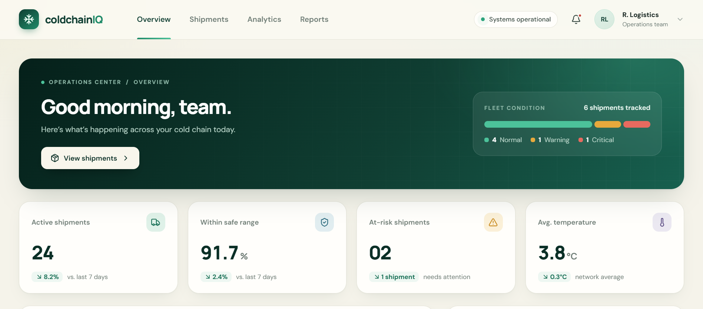
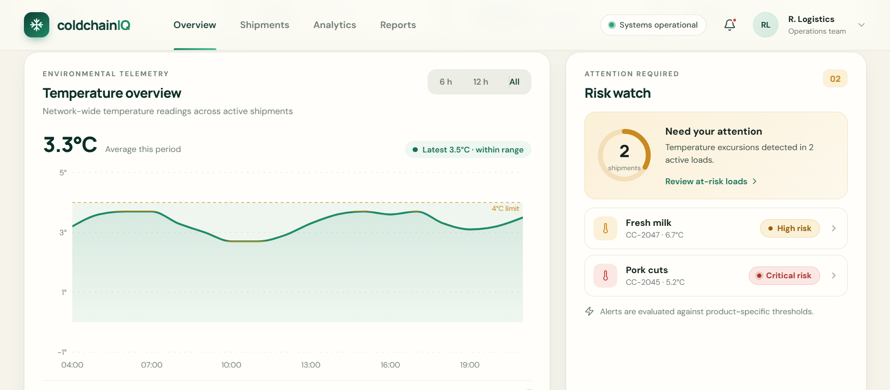
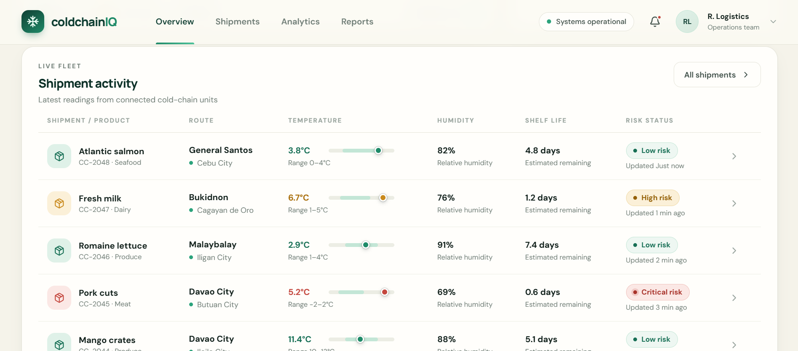
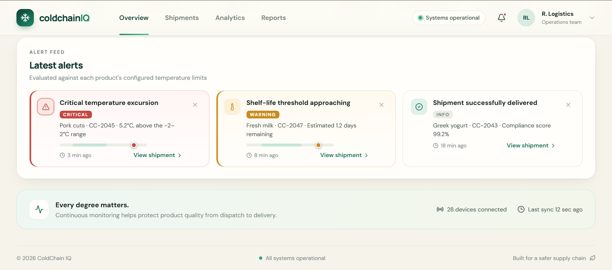
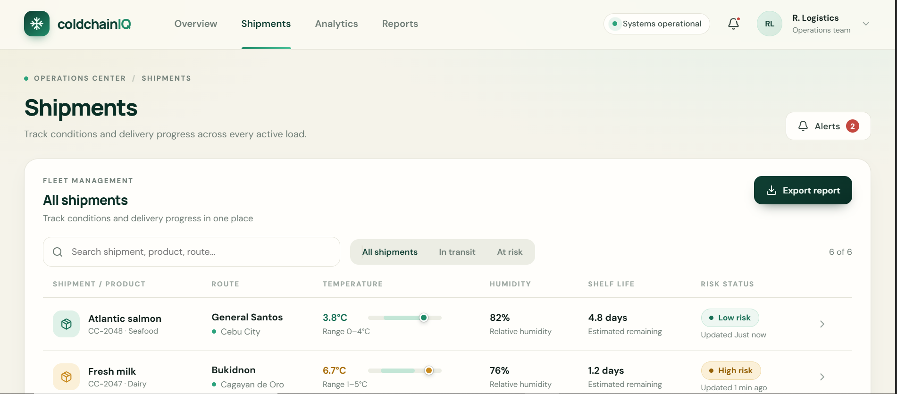
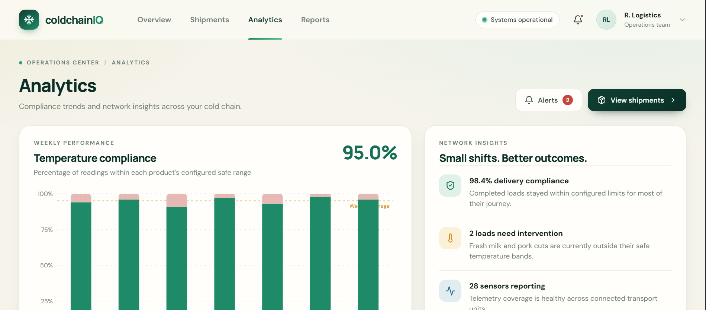
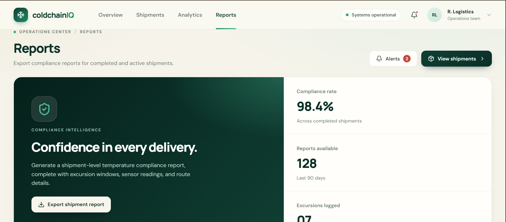

<div align="center">


<br/>


<br/>

**A smart cold-chain monitoring concept for temperature-sensitive shipments.**

<br/>


<br/><br/>

[Overview](#-overview) • [Features](#-key-features) • [Screenshots](#-screenshots) • [Installation](#-getting-started) • [API](#-api-overview) • [Contributing](#-contributing)

</div>

---

<div align="center">


</div>

## 📌 Overview

**ColdChain IQ** is a smart cold-chain monitoring system designed to help track and manage temperature-sensitive shipments. It combines a React-based dashboard, a Python FastAPI backend, and optional MQTT and ESP32 integration to support shipment monitoring, temperature and humidity tracking, spoilage-risk assessment, and improved supply chain visibility.

The platform is designed for distributors, logistics operators, and cold-storage facilities that handle products requiring controlled storage and transportation conditions.

ColdChain IQ aims to make shipment conditions easier to monitor, helping users identify potential temperature issues and make more informed operational decisions.

### 🎯 Project Goals

- Monitor temperature and humidity conditions across shipments.
- Improve visibility into shipment status and environmental conditions.
- Identify potential spoilage risks through temperature-based indicators.
- Provide shipment reports and compliance summaries.
- Support future integration with IoT sensors and connected devices.
- Make cold-chain operations easier to understand through a centralized dashboard.

---

## ✨ Key Features

| Feature | Description |
|---|---|
| **Operations Dashboard** | View shipment summaries, key metrics, alerts, and temperature trends. |
| **Shipment Monitoring** | Review shipment information, status, routes, and environmental readings. |
| **Temperature Tracking** | Monitor temperature conditions and identify possible excursions. |
| **Humidity Monitoring** | Track humidity readings for temperature-sensitive shipments. |
| **Risk Assessment** | Display rule-based spoilage-risk indicators and estimated remaining shelf life. |
| **Analytics** | Present shipment and environmental data in visual formats. |
| **Reports** | View compliance summaries and shipment-related reports. |
| **REST API** | Access shipment information and submit telemetry through FastAPI. |
| **MQTT Integration** | Receive telemetry from connected sensor devices through an MQTT broker. |
| **ESP32 Support** | Includes example firmware for an ESP32 sensor node using DHT22 and DS18B20 sensors. |
| **Responsive Interface** | Provides a clean dashboard layout for desktop and smaller screens. |

---

## ⚙️ How It Works

<div align="center">



</div>

ColdChain IQ is designed around the following workflow:

1. **Collect Data** – Sensors or demo data provide temperature and humidity readings.
2. **Process Telemetry** – The backend receives and processes incoming sensor information.
3. **Assess Conditions** – The system evaluates readings against configured temperature ranges and risk rules.
4. **Monitor Shipments** – Users review shipment status, environmental conditions, and potential alerts.
5. **Review Reports** – Shipment and compliance summaries help users understand operational performance.

---

## 🖥️ Screenshots

Explore the ColdChain IQ dashboard and its main interface sections.

### Dashboard Overview

<div align="center">


<sub>Main dashboard and operational summary.</sub>

</div>

### Overview Interface 2

<div align="center">



</div>

### Overview Interface 3

<div align="center">



</div>

### Overview Interface 4

<div align="center">



</div>

### Shipment Monitoring

<div align="center">



<sub>Shipment information and monitoring interface.</sub>

</div>

### Analytics

<div align="center">



<sub>Visual insights into shipment and environmental data.</sub>

</div>

### Reports

<div align="center">



<sub>Compliance summaries and reporting interface.</sub>

</div>

---

## 🧰 Technology Stack

<div align="center">


</div>

### Frontend
- React
- Vite
- JavaScript
- CSS
- Recharts
- Framer Motion
- Lucide React

### Backend
- Python
- FastAPI
- Pydantic
- Uvicorn

### IoT and Infrastructure
- MQTT
- Mosquitto
- ESP32
- DHT22
- DS18B20
- Docker Compose
- PostgreSQL / TimescaleDB-compatible SQL schema

---

## 🚀 Getting Started

Follow these instructions to run ColdChain IQ locally.

### Prerequisites

Make sure you have installed:

- [Node.js](https://nodejs.org/) 18 or newer
- [Python](https://www.python.org/downloads/) 3.10 or newer
- [Git](https://git-scm.com/)
- [Visual Studio Code](https://code.visualstudio.com/) (recommended)

Optional tools for extended functionality:

- [Docker Desktop](https://www.docker.com/products/docker-desktop/)
- Arduino IDE
- ESP32 development board and compatible sensors

### 1. Clone the Repository

```bash
git clone https://github.com/rheillunio2-byte/ColdChain-IQ.git
```

Navigate to the project directory:

```bash
cd ColdChain-IQ
```

### 2. Start the Backend

Open a terminal in the project directory:

```bash
cd backend
```

Create a virtual environment:

```bash
python -m venv .venv
```

Activate it.

**Windows PowerShell:**

```powershell
.venv\Scripts\Activate.ps1
```

**macOS / Linux:**

```bash
source .venv/bin/activate
```

Install the dependencies:

```bash
pip install -r requirements.txt
```

Start the FastAPI server:

```bash
uvicorn app.main:app --reload --port 8000
```

The backend should now be accessible at:

- API: `http://localhost:8000`
- Interactive API documentation: `http://localhost:8000/docs`
- Health check: `http://localhost:8000/api/health`

### 3. Start the Frontend

Open a **second terminal** in the main project directory:

```bash
cd frontend
```

Install the dependencies:

```bash
npm install
```

Start the development server:

```bash
npm run dev
```

Open the local address displayed in your terminal. It is usually:

```text
http://localhost:5173
```

The frontend can run with its built-in demo data without requiring physical sensors.

### 4. Connect the Frontend to the Backend

Inside the `frontend` folder, create a `.env` file.

Add:

```env
VITE_API_URL=http://localhost:8000
```

Restart the frontend development server after changing environment variables.

> **Note:** The dashboard uses demo data by default. Setting the API URL does not automatically mean every dashboard component is connected to live backend data. Check the relevant frontend data and API integration before treating displayed information as live telemetry.

---

## 📡 Optional MQTT Integration

ColdChain IQ includes an MQTT subscriber in the backend for receiving telemetry from connected devices.

You need an MQTT broker such as Mosquitto.

Configure the backend environment variables:

```env
MQTT_HOST=localhost
MQTT_PORT=1883
MQTT_TOPIC=coldchain/+/telemetry
```

Start the backend after configuring the broker.

### Example Telemetry Payload

```json
{
  "device_id": "ESP32-CC-001",
  "shipment_id": "CC-2048",
  "temperature_c": 3.8,
  "humidity_pct": 82.1
}
```

The subscriber accepts JSON telemetry containing the device ID, shipment ID, temperature, humidity, and an optional recorded timestamp.

---

## 🔌 Optional ESP32 Integration

The project includes example firmware located at:

```text
hardware/esp32-coldchain/esp32-coldchain.ino
```

The firmware is intended for an ESP32 sensor node using:

- DHT22 for temperature and humidity readings.
- DS18B20 for temperature readings.
- MQTT for sending telemetry to the broker.

### Required Arduino Libraries

Install the following libraries through the Arduino IDE Library Manager:

- PubSubClient
- DHT sensor library
- OneWire
- DallasTemperature

Before uploading the firmware, update the Wi-Fi credentials, MQTT broker address, device ID, and shipment ID in the sketch.

**Hardware integration requires a configured MQTT broker and compatible sensor connections.**

---

## 🐳 Optional Docker Setup

The repository includes a `docker-compose.yml` file for starting the supporting infrastructure.

Make sure Docker Desktop is running, then execute this command from the project root:

```bash
docker compose up -d
```

To stop the services:

```bash
docker compose down
```

The provided configuration includes PostgreSQL/TimescaleDB and Mosquitto services. The SQL schema and infrastructure are provided as project components; persistent database integration should be configured before using them for production data storage.

---

## 🔗 API Overview

The FastAPI backend provides the following endpoints:

| Method | Endpoint | Purpose |
|---|---|---|
| GET | `/api/health` | Check API service status |
| GET | `/api/shipments` | Retrieve the shipment list |
| GET | `/api/shipments/{shipment_id}` | Retrieve a specific shipment |
| GET | `/api/shipments/{shipment_id}/readings` | Retrieve shipment readings |
| POST | `/api/telemetry` | Submit sensor telemetry |
| GET | `/api/reports/compliance` | Retrieve a compliance summary |

Visit the interactive API documentation at:

[http://localhost:8000/docs](http://localhost:8000/docs)

---

## 🧠 Risk Assessment

ColdChain IQ includes a rule-based risk assessment concept that considers:

1. Current temperature in relation to the configured product temperature range.
2. The severity and duration of temperature excursions.
3. Estimated remaining shelf life.

The displayed risk levels are intended to support operational awareness and decision-making.

> **Important:** Risk scores and shelf-life estimates are not food-safety certifications. They should not replace calibrated sensors, validated product-specific procedures, qualified food-safety assessments, or applicable regulatory requirements.

---

## 📂 Project Structure

```text
ColdChain-IQ/
│
├── frontend/
│   ├── src/
│   │   ├── components/
│   │   ├── lib/
│   │   ├── App.jsx
│   │   ├── data.js
│   │   ├── main.jsx
│   │   └── styles.css
│   ├── .env.example
│   ├── index.html
│   ├── package.json
│   └── vite.config.js
│
├── backend/
│   ├── app/
│   │   ├── main.py
│   │   ├── ingest.py
│   │   ├── models.py
│   │   ├── mqtt_client.py
│   │   ├── risk.py
│   │   └── store.py
│   ├── sql/
│   │   └── schema.sql
│   ├── .env.example
│   └── requirements.txt
│
├── hardware/
│   └── esp32-coldchain/
│       └── esp32-coldchain.ino
│
├── infra/
│   └── mosquitto.conf
│
├── images/
│   ├── Analytics.PNG
│   ├── Overview.PNG
│   ├── Overview2.PNG
│   ├── Overview3.PNG
│   ├── Overview4.PNG
│   ├── Reports.PNG
│   └── Shipments.PNG
│
├── docker-compose.yml
├── README.md
├── CONTRIBUTING.md
└── LICENSE
```

---

## 🔮 Future Improvements

Potential areas for further development include:

- Real-time shipment tracking and GPS integration.
- Live sensor dashboards and notifications.
- User authentication and role-based access control.
- Persistent database storage and historical analytics.
- Automated alerts for temperature excursions.
- Advanced product-specific shelf-life estimation.
- Improved reporting and export functionality.
- Secure device registration and management.
- Production-ready deployment and monitoring.

---

## 🤝 Contributing

Contributions, suggestions, and feedback are welcome!

You can help improve ColdChain IQ by:

- Reporting bugs and issues.
- Suggesting new features.
- Improving the dashboard interface.
- Enhancing the backend and API.
- Improving IoT and MQTT integration.
- Updating documentation.

Please read [CONTRIBUTING.md](CONTRIBUTING.md) before submitting changes.

---

## 📄 License

ColdChain IQ is licensed under the **MIT License**.

See the [LICENSE](LICENSE) file for the full license text.

---

## 👨‍💻 Developer

<div align="center">

**Developed by RETL**

Rheil Evans Lunio

[](https://github.com/rheillunio2-byte)

</div>

---

<div align="center">


**ColdChain IQ** · Keep every shipment in the safe zone.

<sub>© 2026 Rheil Evans Lunio. Licensed under the MIT License.</sub>

</div>

